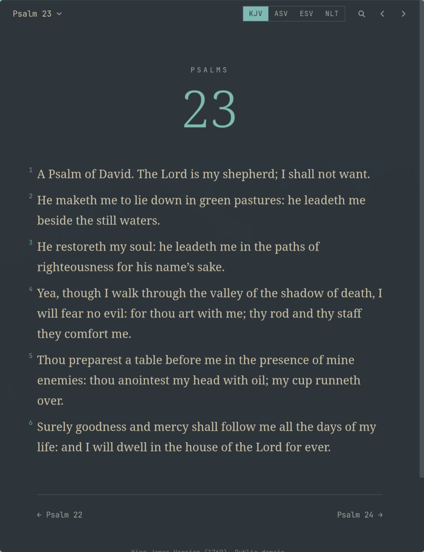

# Lectio

A quiet Bible reader for [Omarchy](https://omarchy.org). It uses your Omarchy colours and font, and changes with your theme.



## Install

```bash
git clone https://github.com/jamers99/lectio
lectio/install.sh
```

Open Lectio from the app launcher, or run `lectio`. Press `?` to see the keys.

Needs `python-gobject`, `webkit2gtk-4.1` and `wl-clipboard`, which Omarchy includes.

## Translations

KJV and ASV download the first time you open them, then work offline.

ESV and NLT come from the publishers' APIs. Get free keys from [api.esv.org](https://api.esv.org/account/create-application/) and [api.nlt.to](https://api.nlt.to/Account/Register), then add them to `~/.config/lectio/config.toml`:

```toml
esv_key = "..."
nlt_key = "..."
font = "Literata"  # optional, the font for the text
```

Search uses the publisher's search for ESV and NLT, so it finds modern wording, and the offline text for KJV and ASV.

To add another public domain translation, add one line to `TRANSLATIONS` in `lectio` using its ID from [bible_databases](https://github.com/scrollmapper/bible_databases/tree/master/formats/json):

```python
"BSB": {"copyright": "Berean Standard Bible. Public domain."},
```

Other online translations need a fetch function like `fetch_esv`.

## Tests

```bash
python3 -m unittest discover -s tests
node --test tests/*.test.mjs
```

## Remove

```bash
rm ~/.local/bin/lectio ~/.local/share/applications/io.github.jamers99.lectio.desktop \
  ~/.local/share/icons/hicolor/scalable/apps/io.github.jamers99.lectio.svg
rm -rf ~/.local/share/lectio ~/.local/share/io.github.jamers99.lectio ~/.cache/io.github.jamers99.lectio ~/.config/lectio
```
